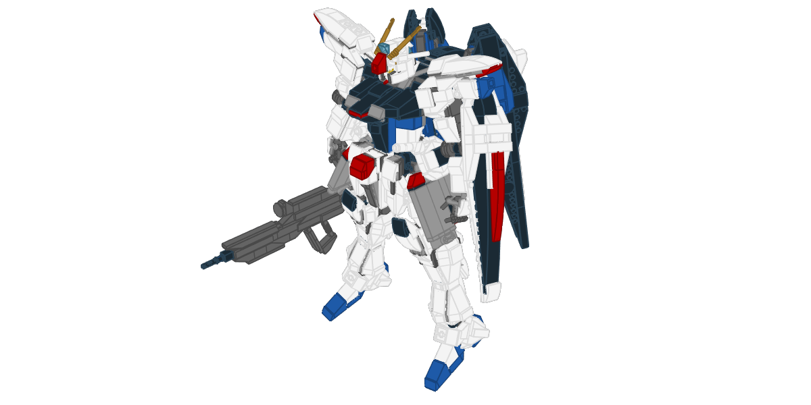
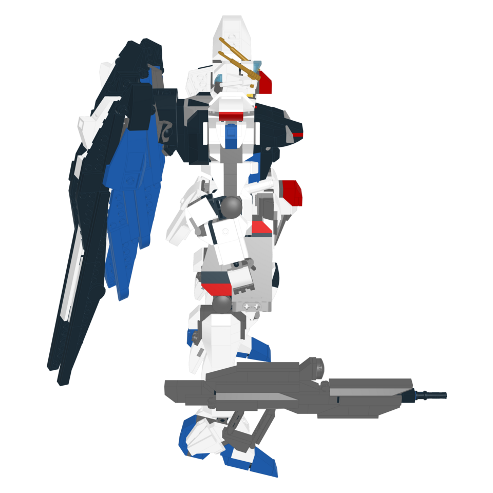
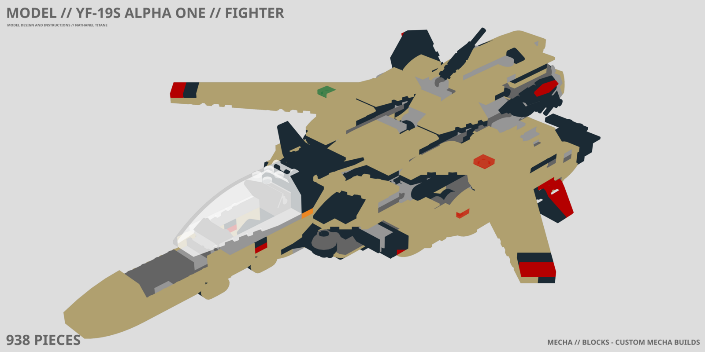
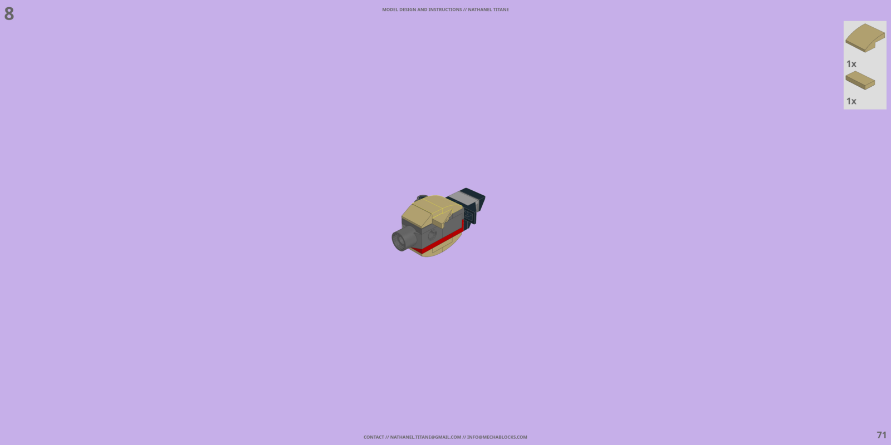
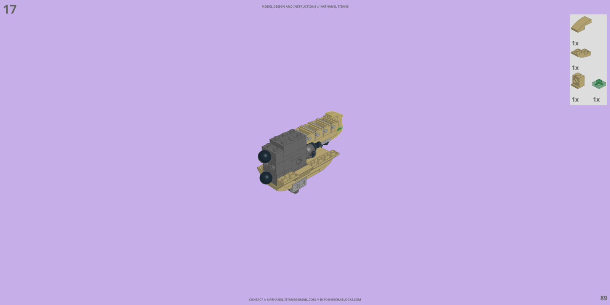
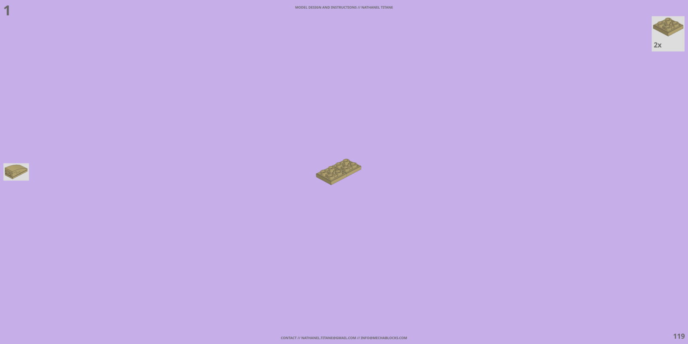
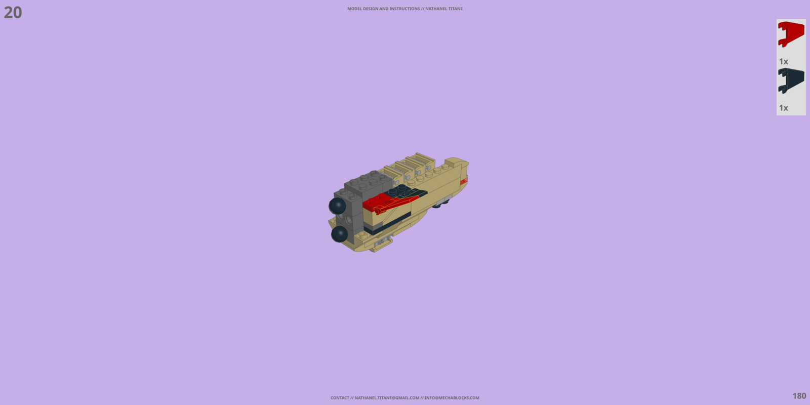
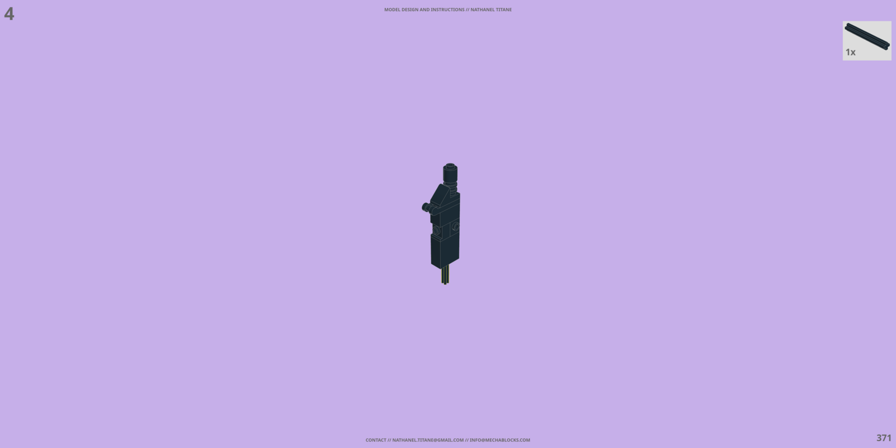

# Site

Every section of [l2cu.app](https://l2cu.app). `tools/l2cu-site` builds the page from this file. Each `##` section starts with a comment that sets its page id, icon and heading, and its first paragraph is the lead. `- **Title.** text` lines become points and `1. **Title.** text` lines steps, a `<!-- table class -->` comment sets the class of the table below it, and a `<!-- gallery class -->` comment turns the images and video links below it into one gallery, the title of a single image setting its figure class. A `<!-- video -->` comment turns the link below it into a looping video. A `<!-- include name -->` comment places content read from the scripts, a paragraph made of links ending in › becomes a more link, and `@NAME@` placeholders are filled with counts read from the scripts.

## Overview

<!-- overview | orange | OVERVIEW // ONE COMMAND FOR A FOLDER OF MODELS -->

L²CU grew out of scripts written to manage LDraw models in bulk, the work an editor makes you do one model at a time. It runs over a whole folder: rendering, exporting, documenting and editing every model in it.

- **Render.** Eight views around every model, or one view as flat, wireframe, overlay, social card or thumbnail, through StudWorx.
- **Export.** Collada, 3D Studio, Wavefront, a parts list or an optimized Blender file, with collada or kmz reduced to its visible surface.
- **Instructions.** Building instructions, piece counts and sample pages with LPub3D.
- **Modify.** Colors, parts and color bound parts changed across every model at once, submodels stepped and files linted.
- **Download.** The official or unofficial LDraw parts library archive, ready for StudWorx.
- **List.** The legacy parts.lst index, sorted by description or number.



Every model found in the chosen directory and its subdirectories is processed, paths with spaces included. LDraw files are plain text, so L²CU edits them as text: no editor opens, nothing is clicked.

## Install

<!-- install | amber | INSTALL // ONE SCRIPT, FETCHED AND RUN -->

Download the script and run it with bash. It sets up what it needs on the first run.

```
curl -s -L -o l2cu https://raw.githubusercontent.com/nathaneltitane/l2cu/main/l2cu
bash l2cu --help
```

1. **Get the script.** L²CU is one bash file: download it anywhere, or keep it in `~/.local/bin` to run it from any folder.
2. **Run it.** On start it loads Frobulator, its scripting library, from `get.frbltr.app` and keeps it up to date.
3. **Install what is missing.** Requirements are checked on each run. Missing ones are offered for install, and root is asked for only then. StudWorx is installed from its latest release package, deb or rpm, for amd64 or arm64.

<!-- table wrap -->
| Requirement | Used for |
| --- | --- |
| <a href="https://studworx.app">StudWorx</a> | Renders, exports and piece counts |
| <a href="https://github.com/trevorsandy/lpub3d">LPub3D</a> | Instructions and sample pages |
| <a href="https://www.blender.org">Blender</a> | The `blender` export |
| python3, numpy | The `surface` export |
| curl | The parts library download |
| sed | Every modification |

### Examples

```
bash l2cu --file mpd --render full --directory ~/models
bash l2cu --file ldr --export collada --directory ~/models
bash l2cu --file mpd --modify step --directory ~/models/work-in-progress
```

Without a directory or a file extension, L²CU asks for them. The defaults are the current directory and mpd files.

## Render

<!-- render | yellow | RENDER // PRESET VIEWS OF EVERY MODEL -->

High definition renders of every model, through StudWorx, saved in a renders folder next to each model.

<!-- table wrap -->
| Option | Output | Saved under |
| --- | --- | --- |
| `full` | Eight 4096 x 4096 views around the model, presets 0 to 7 - the default | `renders/full` |
| `flat` | One view, preset 1, without edges or shading | `renders/flat` |
| `wireframe` | One view, preset 1, edges only | `renders/wireframe` |
| `overlay` | One view, preset 1, with heavy edges | `renders/overlay` |
| `social` | One 1200 x 600 view, preset 1, with edges | `renders/social` |
| `thumbnail` | One 512 x 512 view, preset 1, with edges | `renders/thumbnail` |
| `0` to `7` | One view from that preset | `renders` |

<!-- gallery four square -->





Every preset looks down at 30 degrees of latitude, stepping 45 degrees of longitude around the model.

<!-- gallery three square -->


```
bash l2cu --file mpd --render full --directory ~/models
```

## Export

<!-- export | lime | EXPORT // STANDARD 3D FORMATS -->

Every model exported to a standard 3D format through StudWorx, and Blender for blend files.

<!-- table wrap -->
| Option | Format | Files |
| --- | --- | --- |
| `collada` | Collada, transparency kept for viewers - the default | `dae` |
| `surface` | Collada reduced to its visible surface, parts merged per color | `dae` |
| `kmz` | KMZ archive reduced to its visible surface by StudWorx | `kmz` |
| `csv` | Parts list | `csv` |
| `3dstudio` | 3D Studio | `3ds` |
| `wavefront` | Wavefront | `obj` + `mtl` |
| `blender` | Wavefront joined, smoothed and cleaned up in Blender | `obj` › `blend` |

The surface option applies to collada exports. Exports are saved in an exports folder next to each model, and files above 25 MB are flagged for their loading times.

```
bash l2cu --file mpd --export collada --directory ~/models
bash l2cu --file mpd --export kmz --directory ~/models
```

The exports are ready for web galleries built on WebGL and Three.js, or for sites such as Sketchfab.

[MECHA // BLOCKS ›](https://mechablocks.com) // [Three.js ›](https://threejs.org)

## Instructions

<!-- instructions | green | INSTRUCTIONS // BUILDING GUIDES WITH LPUB3D -->

Building instructions, piece counts and sample pages for every model, generated with LPub3D.

<!-- table wrap -->
| Option | Output |
| --- | --- |
| none | The full instructions document, `pdf` |
| `pieces` | The piece count, written to the pieces file of the model |
| `samples` | Six sample pages spread over the instructions, `png`, saved under `instructions/samples` |

<!-- gallery three -->








Title, piece count, category and address are filled in for each model from a configuration framework. Models flagged with a work-in-progress file get placeholder samples instead.

```
bash l2cu --file mpd --instructions samples --directory ~/models
```

## Modify

<!-- modify | emerald | MODIFY // BULK EDITS ACROSS EVERY MODEL -->

Batch editing for color and part changes that would take hours by hand in an editor, read and written with the LDraw file specification as reference.

<!-- table wrap -->
| Option | Change |
| --- | --- |
| `color` | One color for another, on every part - the default |
| `part` | One part for another, by name or number, in any case |
| `bind` | The color of one part only, matched by part and color |
| `step` | Each ldr submodel reference wrapped in its own step |
| `lint` | The model standardized for parsing: extraneous meta tags and blank lines removed, special characters stripped from submodel names |

- **Any color notation.** Colors are entered by name, number or hexadecimal value. The official LDraw colors are listed when nothing matches.
- **Matched lines only.** Only the part and submodel lines that match are rewritten. Every other line is kept as is, line endings included.
- **Safe copies.** Changes go to a timestamped copy of the model, unless `--overwrite` writes them to the original file.

```
bash l2cu --file ldr --modify color --directory ~/models
bash l2cu --file mpd --modify lint --overwrite --directory ~/models
```

## Download

<!-- download | teal | DOWNLOAD // THE LDRAW PARTS LIBRARY -->

The LDraw parts library, fetched from ldraw.org, for quick updates or for getting started.

<!-- table wrap -->
| Option | Library | Saved as |
| --- | --- | --- |
| `official` | The complete official LDraw parts library - the default | `ldraw.zip` |
| `unofficial` | The complete unofficial LDraw parts library | `ldraw-unofficial.zip` |

StudWorx reads the parts library archive directly, so there is nothing to extract: point it at the archive and render.

```
bash l2cu --download official --directory ~/ldraw
```

## List

<!-- list | cyan | LIST // THE LEGACY PARTS INDEX -->

The parts.lst index for legacy editors, the script that started L²CU.

<!-- table wrap -->
| Option | Sorted by |
| --- | --- |
| `description` | Part description - the default |
| `number` | Part number |

The list replaces the mklist utility packaged with the LDraw library: it indexes every part under the parts folder of the LDraw directory. Moved parts are skipped, and parts with descriptions starting with _ or ~ are listed last.

It serves editors that read the old text index to load their parts, such as MLCAD under Wine. Modern editors build their own index and do not need it.

```
bash l2cu --list number --directory ~/ldraw
```

## Options

<!-- options | blue | OPTIONS // THE FULL HELP -->

Every option and value, read from the help of the script itself. The marked letter is the short option.

<!-- include options -->

## Uninstall

<!-- uninstall | indigo | UNINSTALL // REMOVE INSTALLED COPIES -->

L²CU installs nothing but itself, so removing it removes its copies.

```
bash l2cu --uninstall
```

Every copy of l2cu found on the path is removed. Copies in folders that need the superuser are listed with the command that removes them.

